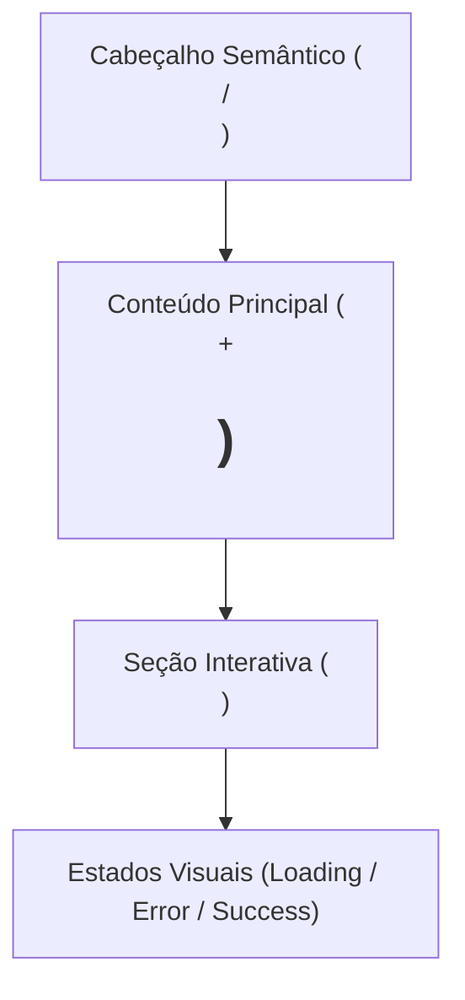

# Especificação de Design, UI/UX e SEO — {{FEATURE_TITLE}}

## 1. Fluxo do Usuário e Hierarquia de Layout

## 2. Componentes e Tokens Visuais
| Componente | Responsabilidade | Props / Estado |
| :--- | :--- | :--- |
| `PageContainer` | Estrutura semântica e responsiva | `title`, `description` |
| `FeatureForm` | Entrada de dados com validação acessível | `isLoading`, `error`, `onSubmit` |

## 3. Estados de Interface Obrigatórios
- **Empty State:** Orientação clara quando não houver dados carregados.
- **Loading State:** Indicador visual (`aria-busy="true"`) prevenindo cliques duplicados.
- **Error State:** Mensagem clara associada ao campo via `aria-describedby` ou `role="alert"`.
- **Success State:** Confirmação visual imediata da ação concluída.

## 4. Requisitos de SEO e Acessibilidade (a11y)
- **HTML Semântico:** Uso adequado de `<header>`, `<main>`, `<section>`, `<article>`, `<nav>` e `<footer>`.
- **Hierarquia de Títulos:** Exatamente um `<h1>` por página descrevendo o propósito central, seguido por `<h2>` e `<h3>` sem pular níveis.
- **Meta Tags & Open Graph:** Definir `<title>` único, `<meta name="description">`, canonical URL e tags Open Graph quando aplicável.
- **Acessibilidade (WCAG AA):** Contraste adequado, navegação completa via teclado (`Tab`/`Enter`/`Escape`), `alt` descritivo em imagens e `label` explícito em todos os campos de formulário.
