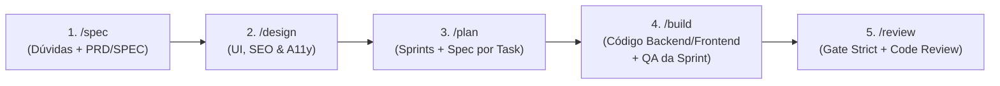

# OpenCode Harness v7 (`opencode-harness`)

> **Desenvolvimento Spec-Anchored por Sprints para o [OpenCode](https://opencode.ai)** — instale um esquadrão enxuto e ultra-performático de **8 agentes**, **7 comandos slash**, **4 skills** e um **Motor Mecânico de Auditoria (Gate)** diretamente na pasta `.opencode/` do seu projeto.

---

## 🎯 Por que a v7?

- **100% Local no Repositório (`.opencode/`):** Sem instalações globais complexas. Versionável no Git junto com o seu projeto.
- **Zero Dependências de Produção (~31 kB):** Pacote NPM leve e instantâneo via `npx opencode-harness`.
- **Sprints + Spec por Task:** Cada tarefa gerada já carrega sua própria especificação técnica (`Spec da Task`), permitindo que `backend` e `frontend` codifiquem rápido sem ler documentos gigantes.
- **Testes Inteligentes por Sprint:** `backend` e `frontend` focam apenas em escrever código limpo. Ao final da Sprint, o `qa-tester` valida as regras de negócio (`BR-XX` e `AC-XX`) **executando exclusivamente os testes relacionados à Sprint entregue**, evitando testes desnecessários ou demorados.

---

## ⚡ Instalação Rápida

Na raiz do seu projeto, execute:

```bash
npx opencode-harness init
```

### Estrutura criada no seu projeto:

```text
meu-projeto/
├── opencode.json                        # Define default_agent: "orchestrator"
└── .opencode/
    ├── CONSTITUTION.md                  # Stack detectada e regras imutáveis do projeto
    ├── harness.json                     # Manifesto de versão e stack
    ├── agents/                          # Os 8 Agentes v7 Turbo (.md)
    ├── commands/                        # Os 7 Slash Commands (/spec, /design, /plan, /build, /review, /quick, /status)
    ├── skills/                          # As 4 Skills Core (spec-driven, doc-standards, security-lgpd, seo-a11y)
    ├── templates/specs/                 # Modelos de PRD, PRODUCT, SPEC, DESIGN e TASKS
    └── specs/                           # Repositório vivo das features e Sprints
```

---

## 🏛️ Os 8 Agentes da v7

| Agente | Modo | Responsabilidade Essencial |
| :--- | :---: | :--- |
| **`orchestrator`** | `primary` | **Só planeja, define produto e designa** (`edit: deny`). Recebe o prompt, faz perguntas para zerar dúvidas, auxilia nas definições de produto e delega aos subagentes. |
| **`spec-engineer`** | `subagent` | **Documentação Oficial:** Escreve e mantém `PRD.md`, `PRODUCT.md`, `SPEC.md` e `AGENTS.md` seguindo a skill `doc-standards`. |
| **`designer`** | `subagent` | Projeta fluxos visuais, os 4 estados de UI (*Empty, Loading, Error, Success*), HTML5 semântico, SEO técnico e acessibilidade (`DESIGN.md`). |
| **`task-planner`** | `subagent` | Gera as **Sprints** (`S01..SN`) e **Tasks** (`T01..TN`) em `TASKS.md`, garantindo que **cada Task possua sua própria Spec (`Spec da Task`)**. |
| **`backend`** | `subagent` | **Só escreve código** de backend (APIs, serviços, banco, regras `BR-XX`) seguindo a `Spec da Task` e preservando comentários existentes. |
| **`frontend`** | `subagent` | **Só escreve código** de frontend (componentes, 4 estados visuais, SEO semântico e acessibilidade) seguindo a `Spec da Task` e `DESIGN.md`. |
| **`qa-tester`** | `subagent` | **Testes por Sprint:** Valida ao final da Sprint se as regras (`BR-XX` e `AC-XX`) estão funcionando, evitando testes inúteis e **rodando apenas os testes da Sprint entregue**. |
| **`code-reviewer`** | `subagent` | Auditoria Read-Only da Sprint com checklist binária de 12 itens (Spec Compliance, Comentários, OWASP, LGPD, SEO e Gate). |

---

## 🔄 Fluxo de Trabalho no OpenCode



### Comandos Slash (dentro do OpenCode):
- **`/spec <demanda>`** — O `orchestrator` tira dúvidas, ajuda a definir o produto e aciona o `spec-engineer` para gerar `PRD.md` e `SPEC.md`.
- **`/design <feature>`** — Aciona o `designer` para criar o `DESIGN.md` da feature (pulado automaticamente se `has_ui: false`).
- **`/plan <feature>`** — Aciona o `task-planner` para criar as Sprints e Tasks com `Spec da Task` em `TASKS.md` e valida no Gate.
- **`/build <feature>`** — Executa as Tasks de código (`backend` / `frontend`) e, ao final da Sprint, aciona o `qa-tester` para testar apenas o escopo da Sprint.
- **`/review <feature>`** — Roda o Gate Mecânico (`--strict`) e a auditoria completa do `code-reviewer`.
- **`/quick <ajuste>`** — Fast-path ágil para demandas simples sem cerimônia completa.
- **`/status`** — Exibe a saúde da instalação e o progresso das Sprints.

---

## 💻 Comandos da CLI (`npx opencode-harness`)

```bash
# Inicializar o harness no projeto atual
npx opencode-harness init

# Criar estrutura de especificação para uma nova feature
npx opencode-harness spec autenticacao-jwt

# Criar especificação para feature de Backend/API pura (sem DESIGN.md)
npx opencode-harness spec webhook-pagamentos --no-ui

# Auditar cobertura de AC-XX, BR-XX e Spec da Task (Gate Mecânico)
npx opencode-harness gate

# Exigir 100% das tarefas da Sprint concluídas [x] (ideal para CI/CD)
npx opencode-harness gate --strict

# Atualizar agentes, comandos e skills preservando CONSTITUTION.md e specs/
npx opencode-harness update

# Diagnosticar integridade da pasta .opencode/
npx opencode-harness doctor

# Visualizar painel geral do projeto
npx opencode-harness status
```

---

## 📄 Licença

Distribuído sob a licença [MIT](file:///home/kingdev/Documentos/Opencode_agents/LICENSE).
